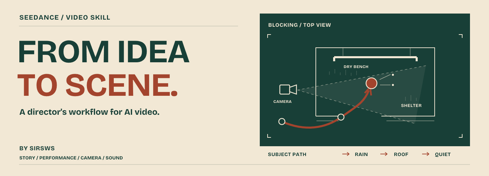

<strong>English</strong> · <a href="README.zh-CN.md">简体中文</a>

<h1 align="center">Seedance Video Skill</h1>

<strong>Give your idea a story, a camera, and a sound.</strong> 
An Agent Skill for directing AI videos, from the first idea to prompts, footage review, and editing.

<a href="#quick-start">Get started</a> · <a href="examples/rain-pavilion.en.md">Try a complete example</a> · <a href="skills/jimeng-12s-video/references/methods.md">Explore the methods</a>

Created by **[SIRSWS](https://github.com/sirsws)**, an AI video creator on Seedance / Jimeng. An independently maintained workflow developed through ongoing AI video creation.

## Make the scene worth watching

“Cinematic. Beautiful. Epic.” leaves a lot for a model to guess. This skill helps you work out **what happens, how the camera reveals it, and what the audience hears** before compiling the prompt.

Content and filmmaking choices develop together: the action that makes an idea interesting, the space an actor moves through, the cut that reveals something, and the sound that changes the scene.

| Bring this | Work toward this |
| :--- | :--- |
| An idea or a theme | Distinct directions with a concrete viewing experience |
| A chosen concept | Actions, performances, camera choices, light, and sound |
| Reference images | Clear roles for identity, costume, setting, and starting state |
| A rough prompt | A coherent prompt matched to the actual generation entry point |
| Generated footage | Evidence-based review and targeted revisions |
| Several clips | Continuity decisions, an edit plan, and authorized local processing |

## A small scene, fully directed

**The brief:** A traveler enters a pavilion in the rain and closes an umbrella. No fight. No dialogue.

| Decision | What it changes |
| :--- | :--- |
| Show the shelter before the traveler arrives | The path and destination are clear. |
| Keep the hands, umbrella, and threshold in frame | Closing the umbrella becomes a readable action. |
| Send the spray away from the dry bench | The action belongs to a real space. |
| Let the rain recede as the traveler steps inside | Sound carries the change from exposure to shelter. |

**[Read the complete example →](examples/rain-pavilion.en.md)** — brief, shot design, a copyable prompt, and what to check in the result. A worked design example, not a generated-video benchmark.

## Quick start

Send this to an assistant that supports Agent Skills:

~~~text
Install the skill at skills/jimeng-12s-video from
https://github.com/sirsws/seedance-video-skill
~~~

Or download the repository and copy the **entire** `skills/jimeng-12s-video` folder into your client's supported skills directory. Keep the references, scripts, and licenses together; reload your client to discover the skill.

Then try:

~~~text
Use $jimeng-12s-video to develop a 15-second rainy-night short.
A traveler enters a wooden pavilion, closes an umbrella, and shakes off the rain.
No fighting or dialogue. Work out the action, camera, and sound.
Give me the final video prompt in English. I will generate it myself.
~~~

The invocation name is kept for compatibility. **`12s` is a legacy name, not a duration limit.** Use the duration supported by your task and platform.

<strong>Already have a concept or footage? Try these.</strong>

**Develop a chosen idea**

~~~text
Use $jimeng-12s-video to develop this chosen concept.
Keep the central event. Improve the staging, camera, and sound.
Deliver the video prompt and copyable reference-image prompts in English.
~~~

**Review a real result**

~~~text
Use $jimeng-12s-video to review this actual generated video.
Separate problems in the concept, staging, prompt, references, and execution.
Revise only what the evidence calls for. Preserve what works.
~~~

## The toolkit

**Brief → Scene design → Reference inputs & prompt → Review & delivery**

| Explore | What you will find |
| :--- | :--- |
| [25 creative routes](skills/jimeng-12s-video/references/methods.md) | Narrative, comedy, suspense, action, dance, spectacle, products, travel, animation, and more |
| [Filmmaking techniques](skills/jimeng-12s-video/references/techniques/INDEX.md) | Camera, staging, performance, light, sound, rhythm, and effects |
| [Reference-image decisions](skills/jimeng-12s-video/references/reference-images.md) | Which inputs are useful, what they control, and what they should leave open |
| [Worked designs](skills/jimeng-12s-video/references/examples.md) | Complete action, camera, and sound treatments |
| [Continuity](skills/jimeng-12s-video/references/sequence-and-continuation.md) | Continuing from actual accepted material across clips |
| [Editing](skills/jimeng-12s-video/references/post-production.md) | Source review, edit decisions, local execution, and export checks |

**Read only what the task needs.** Methods are combined around the scene; a category does not force a plot, shot count, or visual style.

### Languages and platform fit

- **English and Chinese entry guides.** The detailed method library is currently maintained in Chinese. Ask your agent for English or Chinese deliverables.
- **Seedance / Jimeng, with adaptable methods.** Models, duration, upload formats, and identity binding follow the actual app, web, API, or CLI you use.
- **Bring your preferences.** Put identity, taste, format defaults, and asset-library rules in your project's `AGENTS.md`.
- **Generation is a separate action.** The skill provides methods and local helpers. Calling a generation service requires an available tool and your authorization; fees follow that platform.

### Optional local tools

| Task | Dependency |
| :--- | :--- |
| Ideas, scene design, and prompts | An assistant that can read the skill |
| Local trimming, assembly, and captions | Python 3.10+, FFmpeg, and ffprobe |
| Deterministic alpha processing | Python and Pillow |
| Geometric camera / blocking previews | Blender |

Install only what your task needs. A written production package and a finished video are separate deliverables; generated motion, lip-sync, and sound still need actual review.

## Built in the open

This workflow draws on [LearnPrompt/awesome-seedance](https://github.com/LearnPrompt/awesome-seedance), [Emily2040/seedance-2.0](https://github.com/Emily2040/seedance-2.0), [zenstory-ai/drama-skills](https://github.com/zenstory-ai/drama-skills), [liangdabiao/Seedance2-Storyboard-Generator](https://github.com/liangdabiao/Seedance2-Storyboard-Generator), [dexhunter/seedance2-skill](https://github.com/dexhunter/seedance2-skill), and [calesthio/OpenMontage](https://github.com/calesthio/OpenMontage). Thank you to their authors.

See [source attribution and third-party notices](THIRD_PARTY_NOTICES.md) for scope, pinned versions, and licenses. Original work is [MIT licensed](LICENSE); third-party terms are preserved. Independent project; not an official Seedance / Jimeng product.

**Made something with it?** [Share a workflow or suggest an improvement](CONTRIBUTING.md). Reproducible observations help make the methods better.

---

<strong>If this helps you make a better video, give the project a star.</strong> 
It helps other creators find the workflow.  
<a href="https://github.com/sirsws/seedance-video-skill">Star on GitHub</a> ·
<a href="https://github.com/sirsws/seedance-video-skill/issues">Share feedback</a> ·
<a href="README.zh-CN.md">阅读中文版</a>

