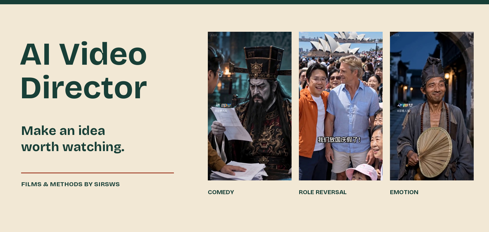

<a href="README.md">English</a> · <strong>简体中文</strong>

# AI 视频导演

**把一个想法，拍成值得看的 AI 视频。**

由 **[邵看人生 · SIRSWS](https://github.com/sirsws)** 在持续创作与观众反馈中整理的 Agent Skill。一起发展创意，设计表演、镜头和声音，准备生成输入，再根据实际视频返修。适用于你选择的视频模型。

[先看代表作](#代表作与背后的创作决定) · [安装使用](#开始创作) · [查看方法库](skills/ai-video-director/references/methods.md)

## 代表作与背后的创作决定

### 阎王不敢收我

人到了阴间，把没还完的账单递给阎王。原本催命的阎王，反过来求他再活五十年。

**微信视频号 22 万播放；即梦 2020 次跟拍。** ¹

一张账单改变双方的强弱关系，造型、表情、对白和阎王的行动一起兑现反差。

[看实际发布视频 ↗](https://www.douyin.com/video/7694977783864836837) · [看创作拆解](showcase/underworld.zh-CN.md)

### 这里有个老外，快合个影

国庆中国游客挤满悉尼歌剧院前，澳洲本地人反倒成了大家争相合影的稀罕对象。

**微信视频号 30.8 万播放。** ¹

地标交代“在哪儿”，人海改变“谁是少数”，老外的困惑反应把笑点落到人物身上。

[看实际发布视频 ↗](https://www.douyin.com/video/7693037053788959673) · [看创作拆解](showcase/sydney.zh-CN.md)

### 今夜，大家都送送他

沿街门窗陆续打开，大家送济公走一程。熟悉的笑容、扇子和离去的背影，完成一次无言告别。

**抖音 3517 赞、276 条评论、309 次收藏。** ²

人物特有的神情和动作，让告别有了具体的情感。作者在济公告别作品的反馈中，特别认可表情、扇子传神，以及音乐的加分。

[看实际发布视频 ↗](https://www.douyin.com/video/7689014871601832057) · [看创作拆解](showcase/jigong.zh-CN.md)

**日常还可以变成大场面：**国庆旅行系列把满山游客变成群侠集结，把敦煌驼队堵车变成骑兵出征。[看旅行到奇观的设计 →](showcase/holiday-spectacle.zh-CN.md)

传播数据的日期与来源

¹ 作者报告的历史快照：《阎王不敢收我》视频号 22 万播放为 2026-10-13，即梦 9.8 万播放、2020 次跟拍为 2026-10-21；《这里有个老外快合个影》视频号 30.8 万播放为 2026-10-08。“跟拍”指其他用户制作同款，不等于播放或点赞。

² 2026-11-08 核对的抖音公开快照。首页只展示多人送行这一部济公作品。

动图摘自所链接的实际发布视频。视频号、即梦的数据归属于对应平台，不能视作所链接抖音版本的数据。这些是具体作品的历史表现，不是对后来作品的效果承诺；方法持续迭代，历史作品也不作为当前 Skill 全部指令的效果测试。

## 你可以用它做什么

从你手上已有的东西继续：一句话、选定构想、参考图、提示词初稿，或实际生成的视频。

| 创作决定 | 一起推进的内容 |
| :--- | :--- |
| **为什么值得看？** | 具体的笑点、情感、揭示、表演或变化过程 |
| **它怎样发生？** | 行动、反应、空间、摄影、光色、节奏与声音一起发展 |
| **交给模型什么？** | 可复制的视频提示词、按需提供的制图词，以及实际参考素材的用途和绑定 |
| **结果哪里需要改？** | 审看真实素材，针对问题返修，处理跨段接续与按需剪辑 |

交付随本次任务确定：先讨论构想、深化一个方向、交完整制作包，或只改一个问题。你可以自己去平台生成，也可以使用已授权且可用的生成工具。

## 开始创作

把这段话发给支持 Agent Skills 的助手：

~~~text
请从 https://github.com/sirsws/ai-video-director
安装 skills/ai-video-director 这个 Skill。
~~~

也可以将 `skills/ai-video-director` 整个文件夹放进所用客户端支持的 Skill 目录，保留参考文件、脚本和许可，再刷新客户端加载。

~~~text
用 $ai-video-director 做一部好笑的 AI 短片。
把一个日常烦恼带进奇幻世界。
给我少量不同构想，每个说清具体行动、关键拍法和观看回报。
我选定后再深化。
~~~

已有方向或视频时：

~~~text
用 $ai-video-director 深化这个已选定的构想。
保留核心事件，把表演、镜头和声音设计清楚。
交付完整视频提示词，以及确实有用的参考图制图词。
我自己去平台生成。
~~~

~~~text
用 $ai-video-director 审看这个实际生成的视频。
指出实际呈现了什么，哪里没达到原本想要的体验。
针对相关拍法、提示词或输入素材修改，保留已经成立的部分。
~~~

**模型和时长按任务选择。** 通用方法负责创意与声画；参考素材、身份绑定、音频、时长和提示词语法，按你实际使用的 APP、网页、API 或 CLI 入口适配。平台说明按需读取。本 Skill 不自带通用生成接口，也不声称各模型表现相同。

**中英文入口与指南。** 详细方法库目前以中文维护，可要求助手用你需要的语言交付。安装过旧版的用户，请用 `ai-video-director` 替换旧 Skill 文件夹，改用上面的新调用名。

## 方法库里有什么

| 当前需要 | 方法入口 |
| :--- | :--- |
| 找到适合本片的做法 | [25 类创作方法](skills/ai-video-director/references/methods.md)：喜剧、叙事、动作、音乐、奇观、产品、旅行、动画等 |
| 落实拍法 | [摄影、表演、光色、声音与节奏](skills/ai-video-director/references/techniques/INDEX.md) |
| 选择有用的输入 | [参考图用途与取舍](skills/ai-video-director/references/reference-images.md) |
| 多段连续创作 | [片段接续](skills/ai-video-director/references/sequence-and-continuation.md) |
| 审看与剪辑真实视频 | [后期流程](skills/ai-video-director/references/post-production.md) |
| 学一个小场景的完整设计 | [雨亭入门教程](examples/rain-pavilion.zh-CN.md)，文字设计练习 |

按当前场景读取，不固定题材、镜数或剧情公式。

构想和提示词只需能读取 Skill 的助手。本地辅助工具按需安装：Python 3.10+、用于剪辑的 FFmpeg/ffprobe、用于 Alpha 处理的 Pillow，以及用于几何预演的 Blender。生成服务另有各自的工具、访问条件与费用。

## 来源与交流

方法整理参考了 [LearnPrompt/awesome-seedance](https://github.com/LearnPrompt/awesome-seedance)、[Emily2040/seedance-2.0](https://github.com/Emily2040/seedance-2.0)、[zenstory-ai/drama-skills](https://github.com/zenstory-ai/drama-skills)、[liangdabiao/Seedance2-Storyboard-Generator](https://github.com/liangdabiao/Seedance2-Storyboard-Generator)、[dexhunter/seedance2-skill](https://github.com/dexhunter/seedance2-skill) 和 [calesthio/OpenMontage](https://github.com/calesthio/OpenMontage)。感谢原作者。[具体来源、版本与许可 →](THIRD_PARTY_NOTICES.zh-CN.md)

原创 Skill 指令、代码与文档采用 MIT 许可；展示影像适用[单独的媒体说明](assets/README.md)。本项目由邵看人生独立维护。

欢迎[分享作品、改进方法或贡献翻译](CONTRIBUTING.md)。如果它帮你做出了更好的视频，欢迎[点一颗 Star](https://github.com/sirsws/ai-video-director)。
