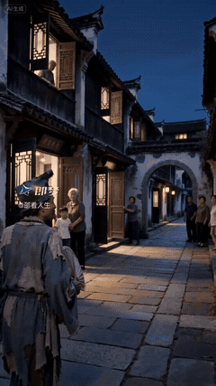

[← 代表作](../README.zh-CN.md#代表作与背后的创作决定) · [English](jigong.en.md)

# 今夜，大家都送送他

从一个人开门招呼，到沿街门窗陆续打开，大家一起目送济公离开。熟悉的笑容和扇子，承载这次想象中的无言告别。

## 创作决定

| 决定 | 在片中的作用 |
| --- | --- |
| 从一个熟人的招呼开始 | 让集体送行有一个具体的人际起点 |
| 沿途门窗陆续打开 | 用别人的行动让关心变得可见 |
| 保留人物特有的笑与摆扇 | 让观众认出熟悉的性情 |
| 从近处交流转为远去的背影 | 用取景改变情感距离 |
| 人走远后，邻里仍留下目送 | 给离去后的空缺留一点时间和空间 |

作者在济公告别作品的反馈中，特别认可表情、扇子传神，也明确认为音乐加分。这是对告别作品的共同反馈，不拆成每个因素贡献多少传播效果。标题下的静音动图只展示画面，音乐请打开实际发布视频听取。

可以这样用：“用 $ai-video-director 设计一次没有对白的告别。通过人物独有的动作、对方的回应，以及末镜留下什么，呈现关系。”

## 已记录反馈

2026-11-08 抖音公开快照：这部多人送行版 **3517 赞、276 条评论、33 次分享、309 次收藏**。代表作展示只采用这一部济公作品。

作品为虚构场景，不将其解释为对真人生死状态的事实报道。拆解依据原设计与已记录反馈，动图来自所链接的实际发布视频。[媒体说明](../assets/README.md)。

相关方法：[叙事与表演](../skills/ai-video-director/references/creation-methods/narrative-dialogue.md)、[声音技法入口](../skills/ai-video-director/references/techniques/INDEX.md)。
