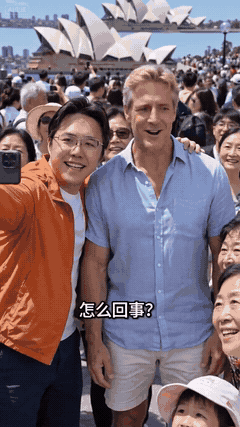

[← 代表作](../README.zh-CN.md#代表作与背后的创作决定) · [English](sydney.en.md)

# 这里有个老外，快合个影

国庆中国游客挤满悉尼歌剧院前，澳洲本地人反成了大家争相合影的对象；听到“我们放国庆长假了”，他开始怀疑自己是不是还在澳大利亚。

## 创作决定

| 决定 | 在片中的作用 |
| --- | --- |
| 让歌剧院保持辨识度 | 先交代地点，才能读懂身份错位 |
| 将人海密度作为笑点的一部分 | 让“本地人反成少数”能被看见 |
| 让近旁游客实际围来合影 | 把背景群众变成参与事件的人 |
| 给老外的困惑留出反应空间 | 由人物完成笑点 |
| 对话时仍保留人群和地点 | 不在近景中丢掉整个情境 |

早期回片只有小群体，地面大片空着。原稿也限定了过少游客，并很快切成紧合影。返修补上完整场景参考图，让前、中、远景都保持人流，后段取景仍保留环境。这是具体的拍法和输入修正。

可以这样用：“用 $ai-video-director 在一个可辨认的地点发展身份错位喜剧。让环境承担设定，再用人物反应完成笑点。”

## 已记录反馈

作者于 2026-10-08 报告：微信视频号 **30.8 万播放**；即梦 **1.8 万播放、357 赞、111 次跟拍**。所链接抖音版本属于另一平台，数据不混用。动图来自该实际发布视频，未用早期失败片替代。

设计和返修记录说明具体做法，不单独证明传播数字的成因。[媒体说明](../assets/README.md)。

相关方法：[喜剧](../skills/ai-video-director/references/creation-methods/comedy.md)、[参考输入](../skills/ai-video-director/references/reference-images.md)。
