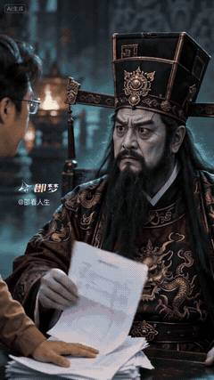

[← Films](../README.md#films-and-the-decisions-behind-them) · [简体中文](underworld.zh-CN.md)

# Even the King of the Underworld Won't Take Me

A man arrives in the afterlife carrying unpaid bills. The ruler who was about to take his life asks him to live another fifty years.

## The directing decisions

| Decision | Its job in the scene |
| --- | --- |
| Carry a familiar financial burden into a supernatural setting | Give the audience an everyday point of entry |
| Establish an imposing ruler before showing the bill | Make the loss of authority readable |
| Let the document pass between the characters | Give the reversal a visible trigger |
| Change the ruler's expression, posture, and behavior | Turn the premise into a performed relationship |
| End with the request to live longer | Complete the reversal in one understandable exchange |

The transferable method is to make a fantasy character answer to a recognizable human problem. A different creature and a different problem need their own behavior, props, and resolution.

Try: “Use $ai-video-director to carry an everyday frustration into a fantasy world. Develop a visible trigger and a change in the characters' relationship; give me distinct ideas before writing the prompt.”

## Recorded response

Creator-reported snapshots: **220,000 views on WeChat Channels** on October 13, 2026; **98,000 views and 2,020 remakes on Jimeng** on October 21. These are separate platforms and dates. The linked Douyin copy has its own counters.

The notes describe the original creative design; the preview is from the actual linked video. The figures do not establish which individual choice caused its reach. [Media terms](../assets/README.md).

Related methods: [comedy](../skills/ai-video-director/references/creation-methods/comedy.md), [dialogue and performance](../skills/ai-video-director/references/creation-methods/narrative-dialogue.md).
