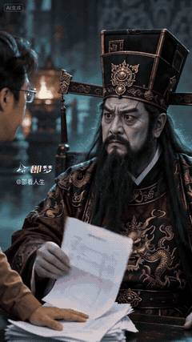

[← 代表作](../README.zh-CN.md#代表作与背后的创作决定) · [English](underworld.en.md)

# 阎王不敢收我

主角把没还完的账单带到阴间，原本催命的阎王反过来求他再活五十年。

## 创作决定

| 决定 | 在片中的作用 |
| --- | --- |
| 把现实还款压力带进阴间 | 给观众一个熟悉的进入点 |
| 先建立阎王的威严 | 让后面的失势有清楚落差 |
| 让账单在人物之间实际交接 | 给关系变化一个可见触发 |
| 表情、姿态和行动一起变化 | 把概念变成两人之间的表演 |
| 以“再活五十年”的请求兑现结尾 | 在一轮交流中完成权力反转 |

可迁移的方法是：让奇幻人物面对一个观众熟悉的现实难题。换人物、换烦恼后，需要重新设计道具、反应和结局。

可以这样用：“用 $ai-video-director 把一个日常烦恼带进奇幻世界。设计一个看得见的触发，让人物关系发生变化；先给不同构想，再写提示词。”

## 已记录反馈

作者报告：2026-10-13 微信视频号 **22 万播放**；2026-10-21 即梦 **9.8 万播放、2020 次跟拍**。平台和日期分别保留，所链接的抖音版本另有自己的数据。

拆解依据原创作设计，动图取自所链接的实际发布视频；这些数字不能单独证明哪项设计导致传播。[媒体说明](../assets/README.md)。

相关方法：[喜剧](../skills/ai-video-director/references/creation-methods/comedy.md)、[对白与表演](../skills/ai-video-director/references/creation-methods/narrative-dialogue.md)。
